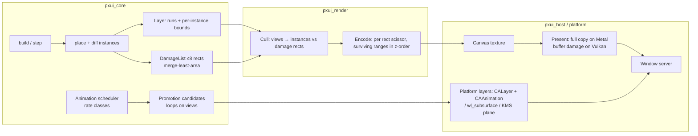

# pxui Render Plan: native-class energy, compositor-grade damage

**Status:** proposal · **Date:** 2026-11-23 · **Scope:** pxui (framework) + LocalWave (first consumer) · **Supersedes:** the open items of `[PERF damage]` (pxui `a64120b4`, LocalWave `01354d9`)

> Goal: a pxui app that shows an animating 14×11-point indicator costs about what a native AppKit app costs. Damage-proportional GPU work, zero app frames for ambient loops, zero warm allocations, and no pixel or behaviour regressions, enforced by gates rather than promises. The same model must carry over unchanged to the Linux Wayland/DRM compositor.

---

## 1. Executive summary

LocalWave playing with the Songs list visible (M1 Air, 2880×1800, 2026-11-23, attached to the shipping release bundle):

| | LocalWave (pxui) | Music.app |
|---|---|---|
| CPU | **9.9 %** (13.8 % with the pointer over it) | 0.07 % |
| GPU (process, AGX `accumulatedGPUTime`) | **8.9 %** (10.4 %) | 0.0 % |
| Frames presented | **28 / s** (48 to 66 / s with the pointer over it) | 0 app frames |
| Activity Monitor energy impact | about 300 (user report) | about 13 |

Five independent causes multiply. Each is fixable without touching what apps author:

1. **Every animation frame is rendered by the app.** Music hands its indicator loop to the Core Animation render server, so the app does no work while it animates. pxui renders and presents a full frame for each step.
2. **Damage is one bounding rectangle.** The equalizer in the list and the clock in the transport union into most of the window, so those frames cost **7 to 17 ms of GPU**.
3. **The whole scene is submitted on every frame.** The scissor only kills fragments, so about **0.55 ms of vertex work runs per frame** whatever changed.
4. **The full-window canvas is copied to the drawable on every frame:** 0.39 ms, or 12 ms/s.
5. **The app renders more often than intended.** A one-shot transition holds the display rate on about 16 of 28 frames, and any input pins endless loops to the display rate for a second.

The plan fixes these in ten packages (R0 to R9). Measurement and gates come first, then the cheap scheduling fixes, damage lists, culling, present measurements, shader cost and pacing. Compositor layers and the Linux host follow. Every package keeps the oracle **"a partial frame equals a full redraw, pixel for pixel"** green, so no change can show stale pixels without failing a test.

Expected results for the same scenario (estimates from the measured breakdown, to be confirmed by R0 tooling):

| After | Presents/s | App GPU | App CPU |
|---|---|---|---|
| today | 28 | 8.9 % | 9.9 % |
| R1 (scheduling) | about 17 | about 5 % | about 6 % |
| R2 to R4 (damage list, culling, present measurements) | about 17 | **≤ 0.6 %** | about 3 % |
| R7 (CA-driven loops) | **5** (clock and playhead ticks only) | **≤ 0.2 %** | **≤ 1 %** |

---

## 2. Measured baseline and method

### 2.1 How the numbers were taken (reproducible, no sudo)

- **Per-process GPU %:** `ioreg -r -c AGXDeviceUserClient -l` gives `accumulatedGPUTime` in ns per `IOUserClientCreator = "pid N, name"`. Take the difference over a window.
- **Frames and per-pass GPU time:** `xcrun xctrace record --template 'Metal System Trace' --attach <pid> --time-limit 5s`.
  - Count `ca-client-present-request` rows to get presents per second.
  - Group `metal-gpu-intervals` by process and encoder ("Render Command 0" is the damage pass, "Render Command 1" is the copy).
  - Use `ca-client-buffer-wait-interval` for drawable waits.
- **Frame reasons:** a temporary diagnostic build counted, per second, why `next_repaint` asked for `now` and why `step` refused. The counters were removed afterwards; R0 makes them permanent behind a flag.

### 2.2 GPU breakdown (5 s, 141 frames, mouse away)

| Pass | GPU ms/s | Per frame |
|---|---|---|
| Damage pass, fragment | 43.3 | p50 0.20 ms · p90 1.9 ms · max **16.9 ms** |
| Damage pass, vertex | 15.5 | 0.55 ms every frame (whole scene) |
| Copy canvas → drawable, fragment | 11.2 | 0.39 ms every frame (full window) |
| Copy, vertex | 0.8 | 0.03 ms |

### 2.3 Frame reasons (per second, steady playback, mouse away)

| Source | Count/s | Meaning |
|---|---|---|
| `step_ok` | 23 | animation steps without a build |
| app builds (`player` ticks) | 5 | clock second (1) + playhead step (4) |
| `next_repaint` → transition | 16 | a non-loop tween is running → display rate |
| `next_repaint` → loop step | 12 | endless loop idle → 30 fps |

The main thread spends about 75 % of samples blocked in `CAMetalLayerPrivateNextDrawableLocked`. Every frame waits for vsync at the start of drawing (`frames_begin`), before any encoding.

### 2.4 Code facts behind the costs

Paths are relative to `pxui/`.

- **Damage:** a single `Option<Rect>` everywhere.
  - Core: `ui_core.rs:1372`, unioned in `add_damage` `:9115`.
  - ABI: `pxui_types/src/ffi.rs:194` and `lib.rs:781`.
  - Host: `graphics.rs` `held`/`union`/`damage_px` `:286-303`.
- **No culling:** `Painter::draw_retained_split` draws every instance of every layer (`pxui_render/src/lib.rs:734`). The scissor is the only limit (`frames.mm:159-173`).
- **Copy every frame:** `frames.mm:190-197` copies the whole canvas into the framebuffer-only drawable on every submit.
- **Scheduling:**
  - `next_repaint` (`ui_core.rs:3701`) returns `now` for any `NO_KEYS` transition, **even a hidden one**, for counted keyframe runs, and for endless loops within `LOOP_IDLE` (1 s) of input.
  - `input_at` is set by any frame with events (`:7655`).
- **Per-pixel cost:** every fragment evaluates two clip SDFs and two derivative sets (`shaders/ui.metal:197-204`). Blending is alpha-only with no opaque fast path, so stacked panels pay full overdraw.
- **Bug found in passing:** `pxui_host` passes `Pass::default()` with `split: None` (`graphics.rs:179`). Any backdrop blur in a `pxui_host` app should then fail with "needs the pass's split callback" (`renderer.rs:384`). This is inferred from the code and needs a runtime check (R0).

---

## 3. Targets (budgets the gates enforce)

Machine of record: M1 Air, 2880×1800 at 2×, release bundle, LocalWave at 10,000 songs.

| Scenario | Presents/s | App GPU | App CPU | Warm allocations |
|---|---|---|---|---|
| Idle, window visible | 0 | 0 | ≤ 0.1 % | 0 |
| Playing, list indicator visible, pointer away | ≤ 5 (≤ 17 before R7) | ≤ 0.2 % (≤ 0.6 % before R7) | ≤ 1 % (≤ 3 % before R7) | 0 |
| Pointer moving over the window, no hover change | 0 | 0 | ≤ 1 % | 0 |
| Scrolling (fling) | display rate | ≤ 25 % | existing p99 budgets | existing ceiling (116 → lower) |
| Hidden, minimized or covered window | 0 | 0 | ≤ 0.1 % | 0 |

Per-frame budgets:
- **Small damage** (≤ 2 % of the window): GPU ≤ 0.15 ms, host CPU (prepare + cull + encode) ≤ 0.25 ms.
- **Full redraw** of the Songs screen: GPU ≤ 2.5 ms (R5 target; today about 10 to 17 ms).

Existing `make performance` limits stay as they are: build p99 < 1.5 ms, frame CPU p99 < 2.5 ms, work wall p99 < 8 ms, zero warm allocations. They may only get stricter.

---

## 4. Non-negotiable invariants (how "no regressions" is made mechanical)

1. **The partial = full oracle.** For any frame sequence, the pixels presented after partial rendering equal those of a full redraw of the same `Ui` state, byte for byte on Metal. On Vulkan/lavapipe the tolerance is ≤ 2 per channel. It runs as:
   - the existing host test
   - a new randomized differential test (R0)
2. **Instance bytes don't change from render-only work.** Culling, damage lists and present strategy live after instance production, in the renderer and host. `bodies_default_identical`, `abi_bench_instances`, `span_equals_engine` and LocalWave fingerprints must stay byte-identical for R2 to R6. R7 changes them only on purpose, with refreshed baselines in the same commit.
3. **Zero warm allocations on both sides of the ABI.** All new structures are fixed-capacity or reserved at layer growth:
   - damage list: an array of 8
   - cull output: reuses the per-layer range buffer
   - Vulkan swapchain image history: one entry per image
4. **Every optimisation has a kill switch and an automatic fallback.** Each is an env flag and a `Graphics` option:
   - `PXUI_FULL_DAMAGE=1` falls back to one full rect
   - `PXUI_NO_CULL=1`
   - `PXUI_NO_LAYERS=1`

   An invalid canvas or a surface resize or reveal forces a full canvas redraw. Metal copies the entire canvas on every present. Vulkan uses a full redraw when a swapchain image has unknown contents.
5. **Behaviour changes are measured both ways.** Each package records before/after `make performance`, abi_bench and the energy scenarios (R0) in its commit message and replaces the status row. No CPU time silently replaces wall time.
6. **One step per commit**, publish pxui before the LocalWave pointer, and follow the ABI rule: one minor bump per additive change, with header, snapshots, fuzz/safety lists, surface row and ledger.

---

## 5. What the industry does (research, with sources)

| Problem | Practice | Source |
|---|---|---|
| Swapchain images don't keep contents | Keep damage history per buffer, keyed by buffer identity; redraw the union since that buffer was last shown | EGL_EXT_buffer_age ([spec](https://registry.khronos.org/EGL/extensions/EXT/EGL_EXT_buffer_age.txt)); Vulkan has no age query, so track by image index ([VK_KHR_incremental_present](https://docs.vulkan.org/refpages/latest/refpages/source/VK_KHR_incremental_present.html)) |
| CAMetalLayer specifically | Flutter Impeller keeps a map from `drawable.texture` pointer to accumulated damage; an unknown pointer means full damage; it uses partial repaint only when damage is ≤ 70 % of the frame | [gpu_surface_metal_impeller.mm](https://flutter.googlesource.com/mirrors/engine/+/refs/heads/main/shell/gpu/gpu_surface_metal_impeller.mm), [compositor_context.cc](https://flutter.googlesource.com/mirrors/engine/+/refs/heads/main/flow/compositor_context.cc) |
| Owning the buffers | Chromium on macOS: its own IOSurface queue (≤ 4, skip `IOSurfaceIsInUse`), damage copied forward per buffer, a `CALayer` tree with IOSurface contents | [buffer_queue.cc](https://chromium.googlesource.com/chromium/src/+/205191a32c9db91062c5342e901b2da2d67a49e5/components/viz/service/display_embedder/buffer_queue.cc), [ca_renderer_layer_tree.mm](https://chromium.googlesource.com/chromium/src/+/HEAD/ui/accelerated_widget_mac/ca_renderer_layer_tree.mm) |
| Damage representation | wlroots: pixman region, collapsed to its bounding box above 20 rects; Chromium cc and Flutter: one rect per surface (the same weakness we have) | [wlr_output_damage.c](https://raw.githubusercontent.com/swaywm/wlroots/master/types/wlr_output_damage.c), [damage_tracker.h](https://chromium.googlesource.com/chromium/src/+/HEAD/cc/trees/damage_tracker.h), [diff_context.h](https://flutter.googlesource.com/mirrors/engine/+/HEAD/flow/diff_context.h) |
| Zero app frames for loops | Core Animation runs committed `CAAnimation`s in the render server; `preferredFrameRateRange` (macOS 12+) lowers the rate | [Apple tech talk 10855](https://developer.apple.com/videos/play/tech-talks/10855), [CAAnimation.preferredFrameRateRange](https://developer.apple.com/documentation/quartzcore/caanimation/preferredframeraterange.md) |
| Layer promotion discipline | Chromium promotes only for direct reasons (transform/opacity animation, video) and squashes overlaps; layers cost memory | [GPU compositing in Chrome](https://www.chromium.org/developers/design-documents/gpu-accelerated-compositing-in-chrome/) |
| Linux equivalents | `wl_surface.damage_buffer`; frame callbacks not sent for hidden surfaces; desynchronized subsurfaces; wlroots scene damage and direct scanout; KMS `FB_DAMAGE_CLIPS` | [wayland.app](https://wayland.app/protocols/wayland), [wlr_scene](https://wlroots.pages.freedesktop.org/wlroots/wlr/types/wlr_scene.h.html), [presentation-time](https://wayland.app/protocols/presentation-time) |
| Pacing | Present only when dirty. Zed holds the full rate about 1 s after input (for ProMotion), and found `presentsWithTransaction` desyncs frames (use it only for resizes). `CAMetalDisplayLink` (macOS 14+) has `preferredFrameRateRange` | [zed.dev/blog/120fps](https://zed.dev/blog/120fps), [CAMetalDisplayLink](https://developer.apple.com/documentation/quartzcore/cametaldisplaylink.md) |
| Load/store on TBDR | `Load` costs a read, `Clear` writes every pixel, `DontCare` is free; drawables need `Store` | [Metal best practices: load/store](https://developer.apple.com/library/archive/documentation/3DDrawing/Conceptual/MTLBestPracticesGuide/LoadandStoreActions.html) |
| Energy numbers | Activity Monitor "energy impact" is a unitless weighted score; prefer Metal System Trace, `powermetrics --samplers tasks,gpu_power --show-process-gpu` and fixed scenarios | [Mozilla perf docs](https://firefox-source-docs.mozilla.org/performance/activity_monitor_and_top.html), [powermetrics(1)](https://keith.github.io/xcode-man-pages/powermetrics.1.html) |

**Unverified, to be settled by R0 spikes:**
- Apple doesn't guarantee that CAMetalLayer drawables keep their contents between uses. Flutter relies on it.
- IOSurface as `CALayer.contents` is undocumented but has shipped in Chromium for years.

---

## 6. Target architecture



Damage flow per frame:
1. Core produces **frame damage**: a list of rects in points, fixed capacity 8.
2. The host converts it to pixels and redraws the canvas within that damage.
3. Metal copies the full canvas into each acquired drawable. Drawables are framebuffer-only except during capture.
4. Vulkan uses per-image history to accumulate **buffer damage**, the union of frame damage since the image was last presented.
5. Linux passes frame damage as a hint where supported by `VkPresentRegionsKHR`, `wl_surface.damage_buffer` or `FB_DAMAGE_CLIPS`.

---

## 7. Implementation plan

Each package is one branch `r<N>` in both repos, lands as one or more single-step commits, and ends with Tier B. R0, R4, R7 and R8 also end with Tier C: `make performance`, release abi_bench in both link modes, `make ios-build`, and the energy scenarios.

### R0. Measurement, oracles and debt (prerequisite; no behaviour change)

**Why:** you can't prove "no regressions, faster" without instruments that run on every package. Today nothing measures GPU time or energy, CI doesn't run pxui at all, and one baseline is already stale.

Work:

1. **Energy scenario runner** `tools/energy/run.sh <scenario> [seconds]` in LocalWave.
   - Launches the signed bundle against an isolated fixture container (never the user library).
   - Drives a fixed scenario through the existing `perf` workload driver in real time instead of as-fast-as-possible: `--energy-playing-list`, `--energy-idle`, `--energy-pointer`, `--energy-hidden`.
   - Records:
     - presents/s from `xctrace`
     - app GPU ms/s per encoder class
     - CPU % and idle wakeups/s
     - `powermetrics` GPU power, when run with sudo; optional
   - Writes `target/energy/<scenario>.json` and compares it against `docs/energy-baseline.json` with explicit tolerances (presents exact, GPU ±10 % or ±0.2 ms/s).
   - Playback in the fixture uses a bundled short silent track looped, so no user media session is touched.
2. **Frame-reason telemetry** behind `PXUI_FRAME_REASONS=1`:
   - Fixed counters in pxui_core for why `next_repaint` returned `now` and why `step` refused, plus app-side reasons in LocalWave.
   - Printed once a second; zero cost when off (one relaxed load).
   - Exposed through `pxui_ui_frame_reasons(ui, out*)` (ABI 2.5) so the energy runner can assert on it.
3. **Differential oracle `partial_equals_full`** in `pxui_host` (Metal) and `pxui_render` (mock and lavapipe):
   - A seeded generator of `Ui` edit sequences: patches, view moves, opacity/scale tweens, keyframe loops, popups, blur views, text changes, resize, theme switch.
   - After every frame it compares the partially drawn target with a full redraw of the same state.
   - 200 seeds in Tier A (under 5 s with a shared device); 5,000 under `RAYS_SLOW=1`.
   - This is the single most important regression net for R2 to R7.
4. **Fix `bodies_default_identical`** (stale since the V1 raster changes). Refresh with `RAYS_UPDATE_FIXTURES=1` after confirming the diff is only the known raster change, and get the owner's sign-off.
5. **Runtime-check the backdrop-blur-without-split path** in `pxui_host`. If it fails, fix it (pass a `split` that ends the encoder, runs the blur passes and reopens with `Load`) with a host test. R3 and R7 need blur to work correctly under damage.
6. **Bump the dylib `current_version`** to match the ABI (2.3.0 → 2.4.0) and gate it in `abi-snapshot`.
7. **CI:** add a pxui job to LocalWave's `verify.yml`:
   - `cargo t` for `pxui_core`, `pxui_render` (mock), `pxui_host` (non-window cases) and `pxui`
   - the `partial_equals_full` mock seeds
   - the `shape/deps/abi-*` gates

   Metal window cases stay local (Tier B).
8. **Record the baseline:** the energy scenarios on the M1 Air (on AC, brightness fixed). The Mac mini repeats them for a second machine of record.
9. **Find the "16/s transition"** with the frame-reason telemetry: log the tween's node key and curve once.

**Exit:** the baseline JSON is committed; the oracle is green on the current code (it must be, since today's partial path is already pixel-tested); CI runs pxui.

---

### R1. Scheduling: render only when the result can differ (cheap, high value)

1. **Hidden one-shot transitions don't drive the display rate.**
   - Today `next_repaint` skips only invisible *keyed* runs (`t.keys != NO_KEYS && !tween_visible`).
   - Apply `tween_visible` to every tween.
   - Hidden tweens advance on time (they are evaluated from `start` and the curve, so no state is lost) and snap when they become visible, or finish without frames.
   - Test: a transition on a node scrolled out of view produces no `repaint_at = now`, and its final pose is correct when it scrolls back.
2. **The transition found in R0.9:** fix it at the source.
   - If it's a LocalWave view keyed on the playhead tick re-entering a transition, key it so the tick patches instead of re-entering.
   - If it's a pxui widget animating a value on every external update (scrub, progress), animate only user-initiated changes.
   - Add a test for the specific widget.
3. **Input pins loops to the display rate only when the input can affect them.**
   - Replace "any event within `LOOP_IDLE`" with "an event that changed hover/press/focus state, scrolled, or reached a widget this frame".
   - Pointer motion that changes nothing (same hover target) no longer counts.
   - Keep the Zed-style 1 s hold after real interaction for ProMotion smoothness.
4. **Ambient loop rate classes.** Keyframes get a `rate` hint:
   - `Rate::Display` (default for transitions)
   - `Rate::Ambient(hz)` (default for `Repeat::Forever`: 30 Hz, as now)

   LocalWave's equalizer uses `Ambient(20)` (Swift's equalizer rate; confirm against the Swift app at 0.5× speed recording). When several loops are due, the scheduler aligns them to one tick so they share frames instead of interleaving.
5. **Coalesce ticks:** a clock-second tick and a playhead step in the same 50 ms window, plus a due loop step, become one frame. Today they are separate frames.
6. **Acquire the drawable late.** Encode the canvas pass first (it doesn't need the drawable) and call `nextDrawable` only right before the present blit. The main thread stops blocking about 16 ms at the start of every frame; input latency and CPU work overlap with vsync.

**Tests:** the scheduler tests in `views.rs` gain rate-class and visibility cases; `window_pxui_idle_loops_step_slower` gets a rate-alignment case; LocalWave's `song-indicators` workload asserts presents/s from the frame-reason counters.

**Exit:** energy `playing-list` presents/s ≤ 17 (≤ 5 from ticks + ≤ 12 loop at 20 Hz aligned). The pointer scenario shows 0 extra frames for motion that changes nothing. `make performance` is unchanged or better.

---

### R2. Damage lists instead of one rectangle

**Core (`pxui_core`):**
- `DamageList { rects: [Rect; 8], len: u8, full: bool }` replaces `Option<Rect>`. Fixed capacity, no heap.
- `add(r)`:
  1. drop it if contained in an existing rect
  2. absorb any existing rects it contains
  3. merge with an overlapping or touching rect if the union adds ≤ 25 % area
  4. otherwise append
  5. on overflow, merge the pair whose union adds the least area (O(n²) with n = 8, about 30 comparisons)
- Total area above 60 % of the viewport becomes `full` (Flutter's 70 % rule, tuned in R0 measurements).
- The `frame_damage`/between-frame carry logic stays identical, just over lists. `drawn()` clears the list.
- Snap to device pixels at the host, not in core (core stays in points).

**ABI 2.5 (additive):**
- `PxuiDamageList { count: u8, full: u8, reserved: [u8; 6], rects: [[f32; 4]; 8] }` in `Output`, plus `pxui_ui_damage_list(ui, out*)`.
- The old single `damage`/`has_damage` fields keep reporting the bounding box, so older consumers stay correct.
- Touches: `ffi.rs`, `lib.rs` `FrameOut`, `pxui_abi/src/ui.rs`, `fuzz.rs`, `safety.rs`, `include/pxui.h`, `abi/pxui.v1.txt` (regenerated), `abi/surface.txt`, `docs/abi.md`, `docs/api.md`, wrapper and docs in `pxui/src/lib.rs`.

**Host:**
- `held` becomes a `DamageList` union.
- `damage_px` maps each rect, rounding out and padding 1 px.
- `Frames::pass` takes `&[[u32; 4]]`. The canvas pass loads, then for each rect sets the scissor, fills the panel colour and draws (cull arrives in R3; until then it draws all instances per rect, which is still a win because fragments only run inside the small rects).
- Rects ≤ 8, so at most 8 scissored draws of the same encoder. No new passes or pipelines.

**Blur and shadow correctness:**
- Any damage rect that intersects a backdrop blur's sampling footprint (the blur rect dilated by its radius ×2 for the downsample) adds the whole blur rect.
- Shadows already have correct bounds in `bounds()` (3σ + spread + offset).
- Both rules live in core, so every host gets them.

**Tests:**
- unit tests for `DamageList` (containment, merge, overflow, full threshold, determinism)
- the existing damage cases converted
- a new case: equalizer row + clock produce two rects with total area < 5 % of the window
- the oracle with multi-rect seeds
- a fuzz target over random add sequences (no panic, every input rect covered)

**Exit:** the energy `playing-list` fragment GPU ms/s drops ≥ 5× (the 7 to 17 ms frames disappear); the oracle is green; instance bytes are unchanged.

---

### R3. Cull geometry to the damage

Instances are already retained per layer, and the core has exact per-instance bounds (`bounds()`, `ui_core.rs:8118`). Make culling hierarchical and allocation-free:

1. **View-level cull (cheap and coarse).**
   - Each retained view already has its run `(from, to)` and composed screen rect `outer`.
   - Export them per layer as a run table: `PxuiRun { from: u32, to: u32, view: u16, screen: [f32; 4] }`. It is maintained by `place`/`compact_layer` (the same places that maintain `dirty`).
   - Fresh, non-view instances between runs get synthetic runs bounded by their union bounds.
2. **Instance-level cull (only inside intersecting runs larger than 64 instances).**
   - A per-layer `bounds: Vec<[f32; 4]>` (view space), parallel to `instances`.
   - Written only where instances are written, so it carries their dirty ranges and the same capacity discipline: no warm allocation.
   - Transformed by the view entry at cull time. Axis-aligned views (the common case) use shift and scale; rotated views take the bounding box of the four corners.
3. **Emit draw ranges in z-order per damage rect.**
   - Contiguous survivors merge, and gaps under 16 instances merge too, to bound draw-call count.
   - Ranges are split at existing texture `breaks`.
   - Output goes into a reused range buffer (capacity reserved to the layer's run count).
   - If survivors exceed 50 % of the instances, draw the whole layer (cull is pointless and the encode is simpler).
4. **Correctness argument, checked by the oracle:**
   - Within a scissor rect R, an instance whose coverage bounds don't intersect R can't write any pixel of R.
   - Skipping it leaves every pixel of R with the same blend sequence as a full draw.
   - This depends on `bounds()` being conservative for every kind: AA fringe, stroke half-width, shadow 3σ, glyph dilate, the light-text 4-tap neighbourhood.
   - Add a test per instance kind: render one instance into an empty target and assert that all non-zero pixels lie inside `bounds()` padded by 1 px.
5. **Where it lives:** `pxui_render` `Painter::draw_retained_split` gains an optional `cull: &CullInput` (rects + run tables). `pxui_abi::renderer::draw` passes it from the host's damage. Instance bytes are untouched, so `bodies_default_identical`, `abi_bench_instances` and fingerprints stay byte-identical.

**abi_bench `gpu` gate:** `DRAW_CALLS` stays the same on full frames. A new `DRAW_CALLS_PARTIAL` case asserts a bound for a one-row change.

**Tests:**
- the bounds-conservative test per kind
- cull unit tests (runs, transforms, breaks, popups layered over base)
- `gpu_warm_frame_allocates_nothing` with cull on
- the oracle

**Exit:** vertex GPU per small-damage frame ≤ 0.03 ms (from 0.55); CPU cull ≤ 20 µs at 10k songs (virtualised); `make performance` frame CPU p99 unchanged (±3 %).

---

### R4. Measure damage-only presentation

Metal measurements on the M1 Mac mini at 1440×872 found that the retained canvas and full
copy use the least GPU time after R3 culling. That path remains in use. Revisit damage-only
presentation for much larger drawables or for Linux. R8 keeps per-image damage history, where
incremental present is a compositor hint. The quiet comparisons are in [the port status](rust-port.md#render-plan-r4).

---

### R5. Make full redraws cheap (fragment cost)

Full redraws still happen (navigation, theme, resize, scroll) and set the felt performance:

1. **Profile:** Xcode shader profiler on the Songs screen full redraw; per-kind cost table.
2. **Specialise the fragment shader** with function constants or uniform branches hoisted per draw range:
   - skip the instance clip SDF when the clip is "none"
   - skip the view clip SDF when the view has no clip (most instances)
   - compute one derivative set unless the instance needs both
3. **Opaque fast path:** fully opaque, untransformed rect instances (panel backgrounds, selection rows) are drawn in an opaque pre-pass front-to-back with depth write, so later blended content behind them is depth-rejected. This cuts overdraw of stacked panels.
   - Gate it by a check that the pass's result equals today's blended output (the oracle plus `gpu_scene_golden`).
   - If depth costs more than it saves on TBDR (measure first), drop it and instead cull fully-covered instances on the CPU using the opaque-rect occlusion list.
4. **Blur:**
   - cap pass-1 taps (65×16 worst case) with a separable downsample chain: 2 passes at ¼ then ½
   - cache the blurred backdrop per blur view while nothing under it changes (keyed by the damage history: no damage under the footprint means reuse)
5. **Text:** confirm atlas uploads are incremental on Apple Silicon (shared storage, `replaceRegion`). On discrete or non-unified hosts, batch the staging blits per frame instead of `waitUntilCompleted` per upload (`uploads.mm:61-71`).

**Exit:** Songs full redraw GPU ≤ 2.5 ms on the M1; `gpu_scene_golden_and_spot_checks`, kit goldens and the gallery stay within tolerance 2; fling GPU ≤ 25 %.

---

### R6. Frame pacing done right

1. **`CAMetalDisplayLink`** (macOS 14+ / iOS 17+, with the current timer path as the fallback):
   - drives frames only while something is due, and is paused otherwise
   - `preferredFrameRateRange` follows the highest active rate class (Display → max; Ambient(20) → 20…30)
   - this keeps ProMotion panels from running at 120 Hz for an indicator
2. **iOS:** the existing pause on resign-active stays. Add the same rate classes; never present while locked (already true) or when the scene is backgrounded.
3. **Hidden windows:** replace the 0.5 s `HIDDEN_WAIT` heuristic with real occlusion state (`NSWindow.occlusionState` change notifications through the SDL host). A fully occluded window does zero frames until visible, and the first visible frame is a full redraw (R4 rule).
4. **Linux (R8):** draw only from `wl_surface.frame` callbacks; use `wp_presentation` feedback for timestamps.

**Exit:** a ProMotion test machine (the Mac mini with an external 120 Hz display if available, otherwise iPhone) shows a 20 Hz present rate for the ambient loop; hidden windows show 0 presents/s.

---

### R7. Compositor layers: ambient loops run outside the app

This is the change that reaches Music-level energy. Scope is deliberately narrow: **promote only views whose motion is fully described by keyframes over view-level properties** (offset, opacity, scale with anchor, 2×2 transform), and which are not overlapped by later content. Everything else stays in the canvas.

**Core model:**
- A view is a **promotion candidate** when it has an endless `animate_keys` loop (or an explicit `ui.promote(view)` hint) and its keyframes touch only view-entry properties (`view_only` tweens already identify this: `ui_core.rs:7859`).
- At `place` time the core checks **z-safety**: no instance later in z-order (same layer or above) intersects the view's swept bounds (union of its keyframe poses).
  - If it's safe, the view's instances are excluded from the canvas and reported in `FrameOut.promoted: &[Promoted { view, swept: Rect, content_revision, keys }]`.
  - If not, it is drawn in-app as today. Correct, only slower.
- Promotion is per-frame data, so hit testing, accessibility and layout are untouched (they never depended on how pixels reach the screen).
- When the loop stops (pause), the final pose is applied, promotion ends, the view's swept bounds are damaged, and the canvas draws it again. The transition is pixel-continuous because both paths evaluate the same curve at the same time.

**macOS/iOS host (`pxui_host` + `metal_sys`):**
- Each promoted view gets a `CALayer` sublayer of the window's content layer, above the CAMetalLayer.
- Its contents are rendered once per `content_revision` into a small IOSurface-backed texture, or into a small `CAMetalLayer` per promoted view if IOSurface contents prove unreliable (decide in the R4 spike).
- Keyframes map to `CAKeyframeAnimation` on `transform`, `opacity` and `position`:
  - `keyTimes`/`values` from pxui `Keys`
  - `timingFunctions` from Bezier curves (exact: `CAMediaTimingFunction` takes the same 4 control points)
  - springs map to `CASpringAnimation` parameters, or are pre-sampled to keyframes with linear timing at the rate class if the mapping isn't exact (verified by the parity test below)
  - `autoreverses`, `repeatCount = .infinity`, phase `offset` maps to `timeOffset`/`beginTime` on a shared `CACurrentMediaTime` base so bars stay phase-locked
  - `preferredFrameRateRange` from the rate class
- Geometry updates (scroll, resize) go through one `CATransaction` with actions disabled, committed in the same frame as the canvas present. Use `presentsWithTransaction` only for frames where both a promoted layer's geometry and the canvas change (Zed's lesson: not always on).
- Clipping: the sublayer's `masksToBounds` plus a mask layer matching the view's clip (scroll container), so a scrolled-off indicator is clipped exactly like the canvas would clip it.

**Linux host (R8):** promoted views become desynchronized `wl_subsurface`s (or wlroots scene buffers with direct scanout candidates). The compositor animates them through its own scene graph in the OS compositor case.

**Correctness gates:**
1. **Layer parity test:** for 200 sampled times across a loop, capture (a) the in-app rendering and (b) the composited window (CARenderer offscreen, or a window screenshot via `CGWindowListCreateImage` in a host test). Assert ≤ 2/channel difference.
2. **Capture path:** `Graphics::screenshot` and the reference goldens composite promoted layers in-app (they force `PXUI_NO_LAYERS` for the capture frame), so goldens never depend on window-server timing.
3. **z-safety test:** a popover opening over a promoted indicator demotes it in the same frame, and the oracle shows no stale pixels.
4. **Fingerprints and instance baselines** change on purpose (promoted instances leave the canvas layer). Refresh them in the R7 commit with a reviewed diff showing only the promoted runs moved.

**Exit:**
- energy `playing-list` presents/s ≤ 5 and app GPU ≤ 0.2 %
- indicator smoothness, judged on a side-by-side recording at 0.5× against the Swift app and Music
- all parity tests green
- `PXUI_NO_LAYERS=1` restores today's behaviour exactly

---

### R8. Linux host: the compositor-grade path

1. **Vulkan presenter in `pxui_host`** (it is Apple-only today):
   - swapchain with per-image damage history (image index → `DamageList`)
   - `VK_KHR_incremental_present` with `VkPresentRegionsKHR` from the frame damage
   - a retained canvas copies accumulated damage into each swapchain image
2. **Wayland:**
   - `wl_surface.damage_buffer` per rect
   - frame-callback-driven pacing
   - `wp_presentation` feedback
   - fractional scale
   - promoted views as subsurfaces (R7)
3. **DRM/KMS** (for the OS compositor itself): `FB_DAMAGE_CLIPS` on the primary plane; promoted layers as overlay-plane candidates; atomic commits per frame.
4. **CI:** lavapipe runs the oracle and goldens (tolerance 2); a physical GPU box runs the energy scenarios via `intel_gpu_top`/`radeontop` or DRM fdinfo engine time.

**Exit:** the oracle is green on lavapipe and one real GPU; the Wayland example shows damage-only commits in `WAYLAND_DEBUG` traces; idle is 0 commits.

---

### R9. Hardening and the 2.0 freeze

- Fuzz the new ABI surfaces (damage list, frame reasons, promoted list).
- Long-run soak: 6 hours of playback, a 2-hour scroll storm, and resize/theme churn. Verify pixel parity in the oracle and zero warm allocations in the soak.
- Freeze the formats into 2.0 (`abi-frozen` and `abi-compat` return to Tier B).
- Write `docs/render.md`: the damage model, culling contract, present strategy, promotion rules and kill switches. Delete the superseded single-rect paths.

---

## 8. Sequencing, effort and expected gain

| Pkg | Effort (focused days) | Risk | Main gain (playing-list) | Depends on |
|---|---|---|---|---|
| R0 | 4 to 5 | low | measurement and nets | — |
| R1 | 2 to 3 | low | presents 28 → about 17, CPU −35 % | R0 |
| R2 | 3 to 4 | medium (ABI, blur rule) | fragment 43 → about 5 ms/s | R0 |
| R3 | 4 to 5 | medium (bounds conservativeness) | vertex 15.5 → about 0.5 ms/s | R2 |
| R4 | 3 to 4 | medium (drawable contents) | measured; Metal full copy retained | R2 |
| R5 | 5 to 7 | medium | full redraw 10 to 17 → ≤ 2.5 ms | R0 |
| R6 | 2 to 3 | low | ProMotion and hidden correctness | R1 |
| R7 | 8 to 12 | high (platform layer sync) | presents 17 → 5, GPU → ≤ 0.2 % | R2, R4, R6 |
| R8 | 10 to 15 | high | Linux parity | R2 to R4, R7 |
| R9 | 3 to 5 | low | freeze and docs | all |

R1 and R2 can run in parallel (different files). R3 and R4 can run in parallel after R2. The Mac mini session runs the benchmarks and soak while the laptop builds.

---

## 9. Risks and mitigations

| Risk | Mitigation |
|---|---|
| Drawable contents can be lost during memory pressure, display sleep or a GPU switch | Metal copies the complete authoritative canvas. Vulkan treats images with unknown contents as fully damaged. |
| `bounds()` isn't conservative for some instance kind, so culling drops pixels | A per-kind conservativeness test, the oracle with random kinds, and a 1 px pad; any failing kind is marked "never cull" until fixed |
| Damage-list merge heuristics create many small draws | Cap of 8, full-damage threshold, gap merge in culling; abi_bench `DRAW_CALLS_PARTIAL` bound |
| Promoted layers drift from canvas timing (phase, rate) | One time base (`CACurrentMediaTime`) for both; parity test over 200 samples; demote on any mismatch |
| Promoted layers break z-order or clipping | z-safety check at place time; clip mask layers; popover demotion test |
| ABI churn for consumers | Additive minors only (2.5 damage list and frame reasons, 2.6 promotion); old single-rect field kept; D28 rules until 2.0 |
| Hidden energy regressions from future features | Energy scenarios in Tier C with committed baselines; presents/s is asserted exactly; frame-reason counters explain any change |
| Goldens or fingerprints change silently | R2 to R6 must keep instance bytes identical by construction; R7 refreshes are reviewed diffs in the same commit |

---

## 10. Definition of done for the whole plan

- Energy `playing-list`: ≤ 5 presents/s, app GPU ≤ 0.2 %, app CPU ≤ 1 %, 0 warm allocations, on the M1 Air. Energy impact in Activity Monitor within 3× of Music in the same scenario (it's a weighted score, so record it but don't gate on it).
- Idle, hidden, pointer-motion scenarios: 0 presents.
- `make performance` all green with limits unchanged or tighter; abi_bench green in both link modes; iOS build and smoke green.
- `partial_equals_full` 5,000 seeds green on Metal and lavapipe, and a 6-hour soak with zero warm allocations.
- Linux Wayland host presents damage-only, frame-callback-paced, with promoted views as subsurfaces.

## 11. Open questions for the owner

1. Equalizer rate: match Swift's exact cadence (verify by recording), or adopt `Ambient(20)` as the pxui default for loops?
2. Approve refreshing `bodies_default_identical` in R0 (stale since V1 raster)?
3. R7 contents path: allow the undocumented IOSurface-as-`CALayer.contents` (Chromium-proven), or require a small `CAMetalLayer` per promoted view?
4. Machine of record for gates: M1 Air only, or M1 Air plus Mac mini?

---

## 12. Execution protocol (fleet)

The orchestrator (the owner's main Claude session) assigns packages to worker sessions. Workers run on the Mac mini.

**Waves**
- **Wave 1:** R0, R1, R2 (parallel)
- **Wave 2:** R3, R4, R6 (after R2 lands)
- **Wave 3:** R5, R7
- **Wave 4:** R8 (Linux machine), R9

**ABI minors are reserved to avoid collisions.** Do not take another package's number; the orchestrator renumbers at landing if the order changes.

| Package | ABI minor | Adds |
|---|---|---|
| R0 | 2.5 | `pxui_ui_frame_reasons` |
| R2 | 2.6 | damage list |
| R1 | 2.7 | if the rate hint needs an export |
| R3 | 2.8 | run tables |
| R6 | 2.9 | repaint rate |
| R5 | 2.10 | backdrop reuse flag |
| R7 | 2.11 | promotion |

**Workspace per package.** Never touch the shared main checkout's working tree.

```sh
git -C <repo> fetch origin && git -C <repo> worktree add ../lw-rN -b rN origin/dev
cd ../lw-rN && git submodule update --init pxui && git -C pxui fetch origin && git -C pxui checkout -b rN origin/dev
```

- Use `CARGO_TARGET_DIR=$PWD/target`.
- Symlink the main checkout's `target/sdl` into it, or build it with `packaging/build-sdl-macos.sh`.

**Commits**
- One step per commit; subjects start with `[R<N>.<step>]`.
- pxui commits on pxui branch `rN`, pushed to the pxui remote first. The LocalWave branch `rN` carries the pointer.
- Do not merge to dev: the orchestrator reviews and lands.

**Gates per package end**
- Tier B: full pxui `cargo t`, `cargo t -p pxui --doc`, `cargo t -p pxui_gallery`, the gates, `make check`.
- R0/R4/R7/R8 also run Tier C: `make performance`, release abi_bench in both link modes, `make ios-build`, and the energy scenarios once R0 provides them.
- Paste the evidence into the final commit message.
- Never raise test deadlines, never refresh goldens or baselines except where this plan says so, and never weaken a gate.

**Report.** Finish with a short report:
- branch heads (both repos)
- what is done and what is not
- gate results with numbers
- anything blocked or needing an owner decision (section 11)
